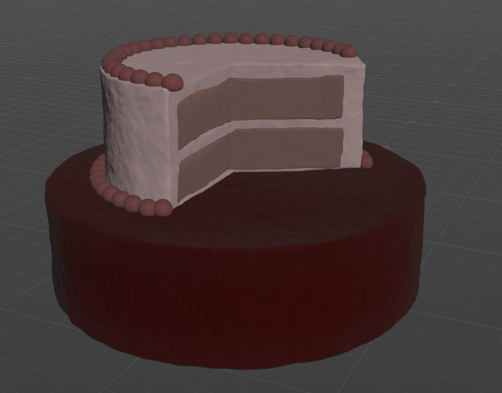

# Final Project: Procedural Cakes
The original assignment description can be found [**here**](https://github.com/CIS-5660-Fall-2026/final-project/blob/main/README.md).

## Project Planning: Design Doc

### Motivation & Goals
To get more experience working with procedural systems in Houdini, I plan to make a tool for procedural cake creation. The idea is to be able to create multi-tier cakes with varying decorations without having to manually place them all.

### References
|  | |  |
|:---:|:---:|:---:|
| *A drip cake* | *A multi-tier cake with various piping frills and borders* | *A cake with pearls and candles* | 
- While there is no comprehensive compilation of cake decorations, there are [**common piping techniques**](https://iscreamforbuttercream.com/12-simple-and-easy-buttercream-cake-borders)
- The anatomy of layered cakes (which is what my tool will be focused on) is described [**here**](https://iscreamforbuttercream.com/anatomy-of-a-decorated-cake/)
- Some existing tools that I will be using as reference are: 
  - [**Procedural Cake Tool**](https://www.xcczheng.com/procedural-cake-tool) (Houdini): for cake options and menu organization
  - [**Procedural Cupcake Generator**](https://blenderartists.org/t/procedural-cupcake-generator/1536718) (Blender): for icing modeling

### Specification & Techniques
The main features of this project are **cake tier stacking**, with each tier having their **own set of decorations** from a selection. Depending on the decoration, they may be parametrable (e.g., piping thickness, scatter pattern).

For getting the HDA set up, I will be referencing the [**procedural house**](https://youtu.be/uIe97023sDk) tutorial from Homework 4. For cake detail creation and placement, some related tutorials that I may reference include Houdini's "[**Cupcake Project**](https://www.youtube.com/playlist?list=PLAu3RshPTj6BSWzdPL8FglQZQBctnE9im)" series and a  [**Procedural Cake Tutorial**](https://youtu.be/0Et-DxwvbYk). For the texture of the cake, I most likely will be using noise referencing [*this tutorial*](https://youtu.be/mORz1y05T7E).

*A loose outline of the tool's workflow/structure:*

### Timeline
- **Milestone 1** (11/11): Creation of cake HDA and its parameters (number of layers; icing properties; texture?)
- **Milestone 2** (11/23): Creation of decoration assets, start of placement logic
- **Final Submission** (11/30): Finish placement logic, polish

## Milestone 1: Cake HDA

I implemented the cake HDA and it's core parameters. Currently, there are parameters for the cake's dimensions, as well as specifications for the cake layer and cream.

The cake is constructed as such:
1. A circle is drawn, its `arc angle` determined by a parameter ("Cake Amount").
2. The circle is extruded by the "Cake Layer Thickness" and beveled
3. It is copied a number of times equal to the number of layers, separated by the "Filling Thickness."
4. The cream builds off of the initial circle, first offset by the Edge Cream amount (if applicable).
5. The offsetted circle is extruded by an amount equal to the height of the cake layers plus the top cream height.
6. The cream layer is "cut" by the cake layer, to create a gap so that if the cake amount isn't the fullest (i.e., 360 degrees), the cake layer is visible.
7. All the parts are merged together and colored, and stacked on top of the previous tier (if existing)

I also attempted to texture the cake and cream, but ran into the issue of some parts of the cake layer being covered as the texturing results in a surface that is not guaranteed to intersect with the exposed cream. 

Also, I ran into an issue where not all of the exposed cream would be removed despite the cake layer fully intersecting with it. Currently, I use a "hacky" method of having a separate set of cake layers that is always the full amount of cake (i.e., 360 arc angle) to cut any overlapping cream.

## Milestone 2: Texturing; Decorations (Start)

A large portion of this period was dedicated to working out the kinks of the cake texturing. While not perfect (there is some offset - i.e., it is not a perfectly flush "cut") the "hacky" method to create the space for the untextured cake layers extened to the textured cake layers. I also convered the cake layer creation nodes into an HDA to minimize clutter (through repeated nodes - I attempted a `for each` block, but the use of `METADATA` invalidated this approach.)

I opted to remove beveling on the icing, as the noise texturing "softens" the edges already (I initially wanted to have uncovered top edges beveled). I also resolved the issue of gaps between the cake tiers by using the `flatten` node on the tops and bottoms of each tier.

I got a small start on decorations - I am going to pare down the scope and focus on top/bottom borders for the time being, though I still hope to be able to implement options of border type.

As can be seen in the demo image, there are slight hitches in the tracing of the borders - namely, with the top border, it doesn't fully adhere to it. Hopefully this can be ironed out by the final submission.

## Final submission (due 11/30)
Time to polish! Spen this last week of your project using your generator to produce beautiful output. Add textures, tune parameters, play with colors, play with camera animation. Take the feedback from class critques and use it to take your project to the next level.

Submission:
- Push all your code / files to your repository
- Come to class ready to present your finished project
- Update your README with two sections 
  - final results with images and a live demo if possible
  - post mortem: how did your project go overall? Did you accomplish your goals? Did you have to pivot?
